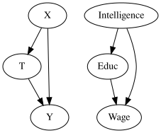
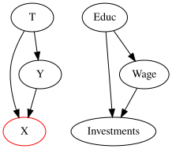
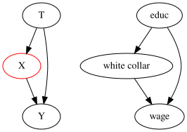
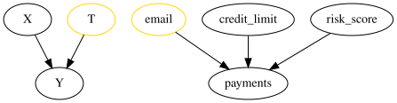
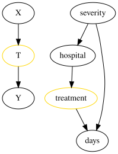
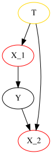

# Summary: Causal Inference for The Brave and True

HandBook: [https://matheusfacure.github.io/python-causality-handbook/01-Introduction-To-Causality.html](https://matheusfacure.github.io/python-causality-handbook/01-Introduction-To-Causality.html)

All content on this page is sourced from the above handbook. The information here won’t make much sense if you haven’t already gone through above handbook.

## **01 - Introduction To Causality**

ATE: Average Treatment Effect

$$
ATE = E[Y_1 - Y_0]
$$

ATT: Average treatment effect on the treated

$$
ATT = E[Y_1 - Y_0 | T=1]
$$

Association is equal to ATT + Bias

$$
E[Y|T=1] - E[Y|T=0] = \underbrace{E[Y_1 - Y_0|T=1]}_{ATT} + \underbrace{\{ E[Y_0|T=1] - E[Y_0|T=0] \}}_{BIAS}
$$

## **02 - Randomized Experiments**

Randomized experiments is the best way to remove bias

## **03 - Stats Review**

We find ATE, but is it statistically significant?

## **04 - Graphical Causal Models**

3 types of graph structures: Linear, Fork, Collider. We saw how to think about conditioning/blocking through graph and how that relates to independence of events.

1. Confounding: Happens when treatment and outcome have a common cause

1. Selection bias: Due to conditioning on a common effect

1. A form of selection bias: Excessive controlling of mediator variables. Selection bias can often be fixed by simply doing nothing

## **05 - The Unreasonable Effectiveness of Linear Regression**

- Regression can be used to perform A/B testing, find CATE and gives us confidence intervals
    - Coefficient of treatment is ATE
    - Intercept is the average value of outcome for untreated subjects
- Regression’s treatment coefficient is the covariance between the treatment and the outcome divided by the variance of the treatment

$$
\beta_1 = \dfrac{Cov(Y_i, T_i)}{Var(T_i)}
$$

- Regression’s treatment coefficient can be interpreted as how the outcome would change with the treatment while keeping all other included variables constant
- Understanding bias: `Short equals long plus the effect of omitted times the regression of omitted on included`. The source of omitted variable bias is confounding
    - Short regression is the one that omits confounding variables
    - Long is the one that includes them

## **06 - Grouped and Dummy Regression**

- Some data points are more important than others. Namely, those with higher sample size and lower variance should be given more weight when estimating a linear model
- Linear regression can even handle grouped anonymized data with elegance, provided we use sample weights in our model.

## **07 - Beyond Confounders**

Variables that are not confounders

1. Variables that are good predictors of the outcome should be added to the model even if they are not confounders. This is because these variable lowers variance of output

1. Bad idea to add variables that predict the treatment but not the outcome

1. Selection bias: Bias that arises when we control for variables in the causal path from the treatment to the outcome or variables that are common effects of the treatment and the outcome

## **08 - Instrumental Variables**

- We can work around omitted variable bias if we have an instrument variable
- An instrument:
    - is correlated with the treatment
    - only affects the outcome through the treatment (exclusion restriction)
- Wald Estimator

$$
\kappa = \dfrac{E[Y|Z=1]-E[Y|Z=0]}{E[T|Z=1]-E[T|Z=0]}
$$

- Estimating the causal effect with IV using 2SLS (2 stages least squares)
    - First stage creates a new version of the treatment that is purged from omitted variable bias (predicting T using Z)
    - We then use this purged version of the treatment, in a linear regression (Predicting Y using predicted T)
    - Control variables (X) should be same for both stages
- IV is no silver bullet
    - It can be quite troublesome when we have a weak correlation with treatment
    - Although consistent, 2SLS is still a biased method to estimate the causal effect

## **09 - Non Compliance and LATE**

- Let’s say that a treatment is assigned randomly, but subjects don’t receive the treatment randomly. That means there is non-compliance
- Treatment assigned is the perfect instrument for the treatment received. It is as good as random and it only affects outcome by the virtue of the treatment received.

## **10 - Matching**

- Subclassification: Partitioning the dataset into cells based on confounders, computing the ATE in each cell and then combining the cell’s ATE into a single ATE for the entire dataset.
- Matching controls for the confounders by looking at each treated unit and finding an untreated pair that is very similar to it and similarly for the untreated units. To implement this method:
    - KNN algorithm
    - de-bias it using regression
- Difference between matching and linear regression: Matching is a non parametric estimator that doesn’t rely on linearity the way linear regression does
- There is a problem of high dimensional datasets which causal inference methods suffer from

## **11 - Propensity Score**

- Probability of getting the treatment is called the propensity score
- If we have the propensity score, we don’t need to control for the confounders directly. It is sufficient to control for the propensity score in order to identify the causal effect
- These properties allowed us to derive a weighting estimator for causal inference

$$
ATE = E\bigg[Y \dfrac{T-e(x)}{e(x)(1-e(x))}\bigg]
$$

- Propensity score can be estimated using logistic regression or other ML approaches
- Issue with propensity score estimation: Increasing the predictive performance of the treatment does **not** translate into a better causal estimate. If we include variables that are very good in predicting the treatment but have no bearing on the outcome this will actually increase the variance of the propensity score estimator.
- **Positivity assumption** of causal inference: `e(x)` and `1-e(x)` should be larger than zero. Each subject needs to have at least some chance of receiving the treatment and of not receiving it.

## **12 - Doubly Robust Estimation**

- Combining linear regression with the propensity score to produce a doubly robust estimator

$$
\hat{ATE} = \frac{1}{N}\sum \bigg( \dfrac{T_i(Y_i - \hat{\mu_1}(X_i))}{\hat{P}(X_i)} + \hat{\mu_1}(X_i) \bigg) - \frac{1}{N}\sum \bigg( \dfrac{(1-T_i)(Y_i - \hat{\mu_0}(X_i))}{1-\hat{P}(X_i)} + \hat{\mu_0}(X_i) \bigg)
$$

- It only requires one of the models to be correct

## **13 - Difference-in-Differences**

- Diff-in-Diff fails if the trend between the treated and control unit is not the same
- Diff-in-diff will be problematic if we only have aggregated data since we won’t be able to find confidence intervals

## **14 - Panel Data and Fixed Effects**

**Re-read is required**

- Panel data: Data where we have multiple measurements of the same individuals across multiple time periods
- When that is the case, we can use a fixed effect model that controls for the entity, holding all individual, time constant attributes, fixed

## **15 - Synthetic Control**

- Synthetic control combines multiple control units to make them resemble the treated unit
- This can be done using linear regression on outcome or some other features
    - We can apply constraints: we will restrict the weights to be positive and sum up to one
- We could use Fisher’s Exact Tests to do inference with synthetic control. We pretend that the non-treated units were actually the treated and computed their effect. These were the placebo effects: the effects we would observe even without a treatment. We uses these to see if the treatment effect we’ve estimated was statistically significant